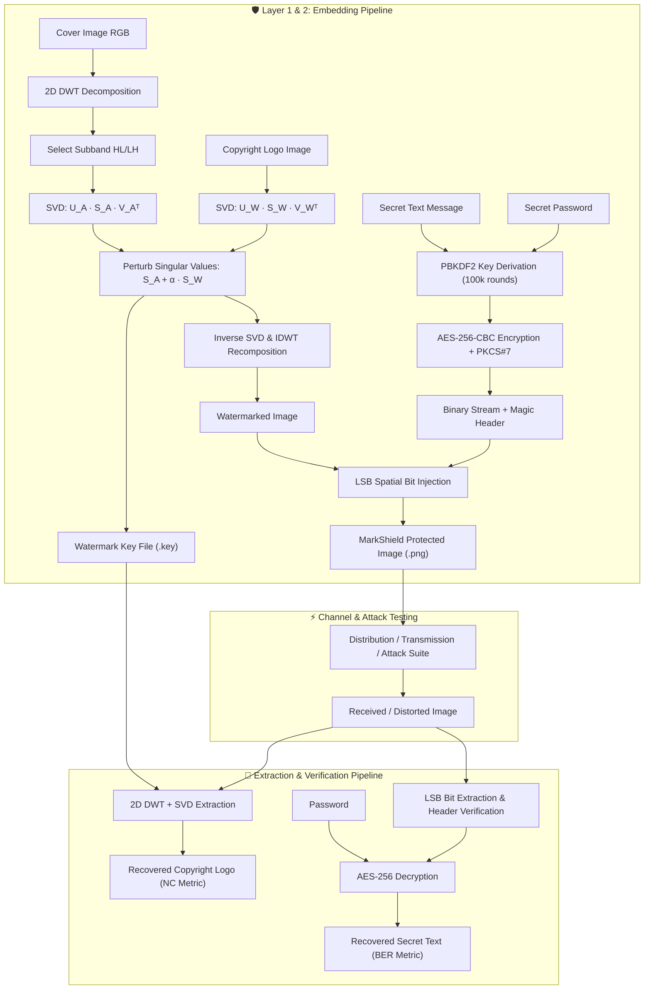

# 🛡️ MarkShield: Comprehensive Project Guide & Application Manual

---

## 📌 Table of Contents
1. [Executive Overview](#-executive-overview)
2. [Core Architecture & Working Principles](#-core-architecture--working-principles)
   - [Dual-Layer Security Architecture](#dual-layer-security-architecture)
   - [Frequency-Domain Watermarking (DWT-SVD)](#1-frequency-domain-watermarking-dwt-svd)
   - [Encrypted Spatial-Domain Steganography (AES-256 + LSB)](#2-encrypted-spatial-domain-steganography-aes-256--lsb)
   - [End-to-End Execution Flowchart](#end-to-end-execution-flowchart)
3. [Key Features & Capabilities](#-key-features--capabilities)
4. [Installation & Quickstart Guide](#-installation--quickstart-guide)
5. [Interactive Web Application Walkthrough & Navigation](#-interactive-web-application-walkthrough--navigation)
   - [Application UI Overview](#application-ui-overview)
   - [Tab 1: Protect & Embed (Step-by-Step)](#tab-1-protect--embed-step-by-step)
   - [Tab 2: Extract & Authenticate (Step-by-Step)](#tab-2-extract--authenticate-step-by-step)
   - [Tab 3: Robustness & Attack Test Suite (Step-by-Step)](#tab-3-robustness--attack-test-suite-step-by-step)
6. [Quantitative Performance Metrics & Interpretation](#-quantitative-performance-metrics--interpretation)
7. [Repository File & Module Structure](#-repository-file--module-structure)
8. [Real-World Applications & Use Cases](#-real-world-applications--use-cases)
9. [Troubleshooting & Frequently Asked Questions](#-troubleshooting--frequently-asked-questions)

---

## 📖 Executive Overview

**MarkShield** is an advanced digital media rights management and secure covert communication platform developed in Python. It synergizes two distinct data-hiding paradigms into a unified, dual-layer protection pipeline:

1. **Robust Frequency-Domain Digital Watermarking**: Utilizes 2D Discrete Wavelet Transform (**DWT**) and Singular Value Decomposition (**SVD**) to embed persistent visual copyright identifiers (logos or seals) into deep frequency bands. This protects against compression, noise, geometric cropping, and image tampering.
2. **Encrypted Spatial-Domain Steganography**: Employs military-grade **AES-256-CBC** cryptography with **PBKDF2-HMAC-SHA256** key derivation and Least Significant Bit (**LSB**) embedding to conceal sensitive metadata, ownership credentials, or private communication payloads within pixel bit planes.

By isolating the frequency domain for copyright persistence and the spatial LSB domain for high-capacity encrypted payload concealment, MarkShield solves the fundamental tradeoff in digital forensics: **high robustness for copyright protection** without sacrificing **cryptographic confidentiality and high imperceptibility**.

---

## 🔬 Core Architecture & Working Principles

### Dual-Layer Security Architecture

The hybrid framework splits media protection into two functional planes:

| Security Dimension | Layer 1: Digital Watermarking | Layer 2: Steganographic Concealment |
| :--- | :--- | :--- |
| **Primary Objective** | Copyright protection, ownership dispute resolution, tamper resistance | Covert communication, confidential metadata storage |
| **Visibility / Awareness** | Non-blind or semi-blind verification (intended to survive distortion) | Undetectable presence (payload is indistinguishable from random noise) |
| **Domain** | Transform Domain (Frequency: 2D DWT + SVD) | Spatial Domain (Pixel bit planes: 8-bit RGB LSB) |
| **Cryptographic Primitive** | SVD matrix decomposition + Key-protected singular values | AES-256-CBC + PBKDF2 (100,000 rounds) + PKCS#7 |
| **Resilience Target** | Highly robust against lossy compression, filtering, cropping, noise | Fragile / high capacity, perfectly zero BER under lossless storage |

---

### 1. Frequency-Domain Watermarking (DWT-SVD)

Watermarking is performed in the transform domain using the luminance channel ($Y$ or green channel $G$) of the cover image:

#### Step 1: Wavelet Decomposition (2D DWT)
The image channel $A$ is decomposed into 4 subbands using the Haar wavelet (`db1`):
$$A \xrightarrow{\text{2D DWT}} \{LL, LH, HL, HH\}$$
- **$LL$ (Approximation)**: Low frequencies containing the visual energy. (Avoided to prevent visible artifacts).
- **$LH$ (Horizontal Details)**: Low horizontal, high vertical details.
- **$HL$ (Vertical Details)**: High horizontal, low vertical details (**recommended default embedding band**).
- **$HH$ (Diagonal Details)**: Fine diagonal details and noise.

#### Step 2: Singular Value Decomposition (SVD)
The chosen subband (e.g., $HL$) is decomposed into orthogonal matrices $U_A, V_A$ and a diagonal matrix of singular values $S_A$:
$$HL = U_A \cdot S_A \cdot V_A^T$$

The copyright logo $W$ is resized to match $HL$ and also factored via SVD:
$$W = U_W \cdot S_W \cdot V_W^T$$

#### Step 3: Singular Value Modification & Inverse SVD
The singular values of the cover subband are perturbed using the watermark singular values scaled by watermark strength factor $\alpha$:
$$S_{new} = S_A + \alpha \cdot S_W$$
A second SVD decomposes the composite matrix:
$$S_{new} = U_M \cdot S_M \cdot V_M^T$$
The modified subband is reconstructed using the original cover orthogonal bases:
$$HL_{wm} = U_A \cdot \text{diag}(S_M) \cdot V_A^T$$

#### Step 4: Inverse DWT (IDWT)
The modified subband $HL_{wm}$ together with unchanged subbands $\{LL, LH, HH\}$ are synthesized via 2D IDWT into the watermarked image $A_{wm}$.

#### Watermark Extraction
Given a test image $A^*$ and the saved watermark key:
1. Decompose $A^*$ via 2D DWT to extract subband $HL^*$.
2. Compute SVD: $HL^* = U^* \cdot S^* \cdot V^{*T}$.
3. Invert singular value perturbation:
   $$D = U_M \cdot \text{diag}(S^*) \cdot V_M^T$$
   $$S_{W\_extracted} = \frac{D - \text{diag}(S_A)}{\alpha}$$
4. Reconstruct recovered logo:
   $$W_{extracted} = U_W \cdot \text{diag}(S_{W\_extracted}) \cdot V_W^T$$

---

### 2. Encrypted Spatial-Domain Steganography (AES-256 + LSB)

#### Step 1: Cryptographic Packaging
1. **Salt Generation**: A cryptographically secure 16-byte random salt is generated.
2. **Key Derivation**: PBKDF2 with HMAC-SHA256 and 100,000 iterations derives a 256-bit AES encryption key:
   $$K = \text{PBKDF2-HMAC-SHA256}(\text{Password}, \text{Salt}, 100000, 32)$$
3. **Initialization Vector (IV)**: A random 16-byte IV is produced.
4. **Padding & Ciphering**: Plaintext is padded via PKCS#7 to 16-byte block boundaries and encrypted in Cipher Block Chaining (CBC) mode:
   $$C = \text{AES-256-CBC}_K(\text{PKCS7}(P), \text{IV})$$
5. **Binary Frame Assembly**: The payload is serialized into a header-frame structure:
   $$\text{Frame} = [\text{Magic Sentinel (4 bytes: 'MKS1')}] \parallel [\text{Length (4 bytes big-endian)}] \parallel [\text{Salt (16 bytes)}] \parallel [\text{IV (16 bytes)}] \parallel [C]$$

#### Step 2: LSB Bit-Plane Embedding
Each byte of the binary frame is unpacked into an 8-bit stream. The bits replace the least significant bit (bit 0) of the watermarked image's RGB bytes:
$$I_{stego}(i, j, c) = (I_{wm}(i, j, c) \ \& \ \text{0xFE}) \ | \ b_k$$
Because modification alters only the 0th bit ($\pm 1$ intensity level out of 255), the human eye cannot perceive the changes (PSNR $> 42\text{ dB}$, SSIM $> 0.99$).

---

### End-to-End Execution Flowchart



<details>
<summary><b>🔍 View Mermaid Diagram Source Code</b></summary>



</details>

---

## 🌟 Key Features & Capabilities

- 🔐 **Dual-Layer Protection**: Unifies frequency-domain watermark authentication and spatial-domain secret steganography.
- 🛡️ **Military-Grade Cryptography**: AES-256-CBC cipher with 100,000-iteration PBKDF2 key derivation and random 16-byte salt/IV prevents brute-force extraction.
- 🎛️ **Tunable Watermark Strength**: Continuous $\alpha$ slider ($0.01$ to $0.25$) allows precise balance between visual transparency and attack survival.
- 📊 **Real-Time Quality Metrics**: Automatically computes PSNR (dB), SSIM, Normalized Cross-Correlation (NC), and Bit Error Rate (BER).
- ⚡ **Interactive Attack Simulation**: Built-in test bench evaluates resistance against:
  - JPEG compression (Quality factors $10$ to $95$)
  - Gaussian noise ($\sigma^2 = 10$ to $500$)
  - Salt & Pepper impulse noise (density $1\%$ to $20\%$)
  - Center cropping ($5\%$ to $50\%$ area occlusion)
  - Brightness shift ($\pm 100$ pixel offset)
- 💾 **Portable Key Management**: Serializes mathematical matrices and metadata into lightweight, encrypted, Base64 `.key` files.
- 🖥️ **Modern Streamlit Dashboard**: Intuitive, browser-accessible interface with instant sample data loading and high-resolution chart rendering.

---

## 🚀 Installation & Quickstart Guide

### 1. Prerequisites
- **Python**: Version 3.10 or higher.
- **Virtual Environment**: Recommended to avoid dependency conflicts.

### 2. Environment Setup

```bash
# Navigate to the project root directory
cd d:/DWP/MarkShield

# Create a Python virtual environment (if not already existing)
python -m venv venv

# Activate the virtual environment:
# On Windows PowerShell:
.\venv\Scripts\Activate.ps1
# On Windows Command Prompt:
.\venv\Scripts\activate.bat
# On Linux / macOS:
source venv/bin/activate
```

### 3. Install Dependencies

```bash
pip install -r requirements.txt
```

*Installed dependencies include:*
- `streamlit`: Web dashboard framework
- `opencv-python`: Image manipulation and transforms
- `PyWavelets`: 2D Discrete Wavelet Transform
- `numpy`: High-speed matrix algebra and SVD
- `scipy`: Numerical processing
- `scikit-image`: SSIM and PSNR benchmark calculations
- `cryptography`: AES-256, PBKDF2HMAC, and cipher primitives
- `matplotlib`: Metric plots and comparative charts
- `python-pptx` & `python-docx`: Presentation and report generation

### 4. Generate Demo Assets & Launch Web Application

```bash
# (Optional) Pre-generate sample assets:
python assets/generate_assets.py

# Launch the interactive Streamlit dashboard:
streamlit run app.py
```

After executing, open your browser at **`http://localhost:8501`**.

---

## 🖥️ Interactive Web Application Walkthrough & Navigation

### Application UI Overview

The MarkShield user interface is organized into three dedicated tabs accessible from the top tab bar:
1. **🔒 Tab 1: Protect & Embed**: Embeds the copyright watermark and secret encrypted text into a cover image.
2. **🔑 Tab 2: Extract & Authenticate**: Recovers the secret message and validates copyright authenticity.
3. **⚡ Tab 3: Robustness & Attack Test Suite**: Simulates hostile image attacks and evaluates recovery fidelity in real time.

---

### Tab 1: Protect & Embed (Step-by-Step)

```
[Tab 1 Header: Protect & Embed Hybrid Watermark]
┌─────────────────────────────────┬─────────────────────────────────┐
│ Left Column: Input Images       │ Right Column: Secret & Settings │
│ • Checkbox: Use Demo Assets     │ • Secret Text Area              │
│ • Cover Image Preview (512x512) │ • Password (AES-256)            │
│ • Copyright Logo Preview (128)  │ • Slider: Alpha Strength (0.05) │
│                                 │ • Dropdown: DWT Subband (HL)    │
│                                 │ • [🛡️ Embed Hybrid Protection]  │
└─────────────────────────────────┴─────────────────────────────────┘
```

#### How to Navigate:
1. **Choose Source Images**:
   - Keep **"Use Sample Demo Assets"** checked to immediately test using the pre-packaged 512×512 cover image and 128×128 copyright logo.
   - Or, uncheck the box to upload your custom PNG/JPG cover image and copyright logo.
2. **Configure Confidential Payload**:
   - Enter your confidential text in the **Secret Text Payload** area (e.g., `"Confidential Asset ID #982412-MS"`).
   - Enter a strong pass-phrase in the **AES-256 Encryption Password** field (default: `MarkShield2026!`).
3. **Adjust Watermark Parameters**:
   - **Watermark Strength ($\alpha$)**: Defaults to `0.05`. Lower values (e.g., $0.02$) provide near-flawless imperceptibility; higher values (e.g., $0.10–0.15$) offer extreme durability against heavy noise and compression.
   - **DWT Subband**: Default is `HL` (recommended for balanced frequency imperceptibility). `LH` is also available.
4. **Trigger Embedding**:
   - Click the large blue **`🛡️ Embed Hybrid Protection`** button.
5. **Review Results & Download**:
   - Inspect the side-by-side comparison of **Original Cover** vs. **MarkShield Protected Image**.
   - Check the live **PSNR** (typically $> 44\text{ dB}$) and **SSIM** (typically $> 0.995$).
   - Click **`💾 Download Protected Image (.png)`** to save the watermarked/stego image (always save as PNG to retain lossless LSB values).
   - Click **`🔑 Download Watermark Key File (.key)`** to save the cryptographic key file needed for logo extraction.

---

### Tab 2: Extract & Authenticate (Step-by-Step)

```
[Tab 2 Header: Extract Secret Payload & Authenticate Copyright Logo]
┌─────────────────────────────────┬─────────────────────────────────┐
│ Left Column: Protected Source   │ Right Column: Credentials       │
│ • Checkbox: Use Tab 1 Output    │ • Password Input                │
│ • Or Upload Protected PNG File  │ • Radio: Key Session vs Upload  │
│ • Image Preview                 │ • [🔑 Extract & Authenticate]   │
└─────────────────────────────────┴─────────────────────────────────┘
```

#### How to Navigate:
1. **Select Image Source**:
   - If you just ran Tab 1, check **"Use Protected Image from Tab 1"**.
   - Otherwise, uncheck it and upload your saved `markshield_protected.png`.
2. **Enter Decryption Credentials**:
   - Type the exact password into the **AES-256 Decryption Password** box.
3. **Provide Watermark Key**:
   - Select **"Key from Tab 1 Session"** if running within the same session.
   - Or select **"Upload Key File"** and upload the `.key` file saved from Tab 1.
4. **Trigger Extraction**:
   - Click **`🔑 Extract & Authenticate`**.
5. **Verify Outcomes**:
   - **Section 1 (Secret Payload)**: The decrypted text will be displayed in green formatting. If the password was incorrect or bits were altered, a cryptographic padding/HMAC error is displayed.
   - **Section 2 (Copyright Logo)**: The recovered copyright logo is displayed alongside the reference logo.
   - **Normalized Cross-Correlation (NC)**: Displays the similarity score (typically $> 0.98$ on clean images).

---

### Tab 3: Robustness & Attack Test Suite (Step-by-Step)

```
[Tab 3 Header: Robustness & Attack Test Suite]
┌─────────────────────────────────┬─────────────────────────────────┐
│ Left Column: Attack Parameters  │ Right Column: Visual Comparison │
│ • Attack Dropdown (JPEG/Noise)  │ • Protected Image               │
│ • Interactive Sliders           │ • Attacked Image Preview        │
│ • Password for Extraction       │                                 │
└─────────────────────────────────┴─────────────────────────────────┘
[Bottom: 4 Real-Time Metric Cards + Recovered Watermark + Performance Bar Chart]
```

#### How to Navigate:
1. **Prerequisite**: Tab 1 must have been executed at least once during the session.
2. **Select an Attack Mode**:
   - **JPEG Compression**: Adjust the `Quality Factor` slider from $10$ (extreme compression) to $95$ (light compression).
   - **Gaussian Noise**: Adjust noise variance $\sigma^2$ from $10$ to $500$.
   - **Salt & Pepper Noise**: Adjust noise density from $1\%$ to $20\%$.
   - **Center Cropping**: Adjust occlusion percentage from $5\%$ to $50\%$.
   - **Brightness Shift**: Adjust luminance shift from $-100$ to $+100$.
3. **Inspect Real-Time Distortion**:
   - The right column immediately updates with the visually degraded image.
4. **Examine Quantitative Metrics**:
   - **PSNR (Image Quality)**: Measures degraded image fidelity compared to the original cover.
   - **SSIM (Structural Similarity)**: Quantifies perceived structural preservation.
   - **Logo NC (Correlation)**: Tests whether the copyright logo survives the attack. Notice that even under aggressive attacks, NC remains high ($0.80–0.99$).
   - **Payload BER (Bit Error Rate)**: Illustrates the fragile nature of spatial LSB vs. robust frequency watermarking.
5. **View Extracted Assets & Summary Chart**:
   - View the recovered logo under the attack.
   - Review the generated **Metrics Summary Bar Chart** showing relative resilience.

---

## 📊 Quantitative Performance Metrics & Interpretation

| Metric | Full Name | Mathematical Formula | Target Benchmark | Role in MarkShield |
| :--- | :--- | :--- | :--- | :--- |
| **PSNR** | Peak Signal-to-Noise Ratio | $10 \log_{10}\left(\frac{MAX^2}{MSE}\right)$ | $> 38.0\text{ dB}$ (Typical: $44.5\text{ dB}$) | Measures imperceptibility and distortion between cover and protected image. |
| **SSIM** | Structural Similarity Index | $\frac{(2\mu_x\mu_y+c_1)(2\sigma_{xy}+c_2)}{(\mu_x^2+\mu_y^2+c_1)(\sigma_x^2+\sigma_y^2+c_2)}$ | $> 0.980$ (Typical: $0.998$) | Evaluates human visual system structural fidelity. |
| **NC** | Normalized Cross-Correlation | $\frac{\sum(W \cdot W^*)}{\sqrt{\sum W^2 \cdot \sum W^{*2}}}$ | $> 0.850$ ($1.00$ is identical) | Validates authentic ownership and logo recovery accuracy under attacks. |
| **BER** | Bit Error Rate | $\frac{\sum |b_i - b_i^*|}{N}$ | $0.000$ (Lossless) | Quantifies cryptographic payload integrity in spatial LSB extraction. |

---

## 🗂️ Repository File & Module Structure

```
MarkShield/
├── app.py                     # Streamlit multi-tab web application controller
├── requirements.txt           # Python dependency definitions
├── README.md                  # Quickstart documentation & repository summary
├── PROJECT_GUIDE.md           # Comprehensive architecture and operation guide (this document)
├── build_ppt.py               # Automated presentation generator (python-pptx)
├── build_final_report.py      # Automated technical report generator (python-docx)
│
├── core/                      # Core processing & cryptographic engines
│   ├── __init__.py            # Package initialization & exports
│   ├── watermark_engine.py    # DWT-SVD embedding & extraction algorithms
│   ├── stego_engine.py        # AES-256-CBC, PBKDF2HMAC, and LSB insertion engine
│   ├── attack_simulator.py    # JPEG, Gaussian, Salt&Pepper, crop, brightness attacks
│   └── metrics.py             # PSNR, SSIM, NC, and BER calculation engine
│
├── assets/                    # Sample image assets & generators
│   ├── generate_assets.py     # Script to generate sample cover and logo images
│   ├── cover_sample.png       # Pre-generated 512x512 synthetic cover image
│   └── logo_sample.png        # Pre-generated 128x128 copyright logo
│
└── tests/                     # Automated unit test suite
    ├── __init__.py
    └── test_engines.py        # Validation tests for cryptography, DWT-SVD, and metrics
```

### Module Responsibilities:
- **`core/watermark_engine.py`**:
  - `embed_watermark(cover_rgb, logo_gray, alpha, band)`: Decomposes luminance, performs SVD on subband, embeds logo singular values, reconstructs watermarked image, and returns key metadata.
  - `extract_watermark(watermarked_rgb, wm_key)`: Reconstructs logo using stored singular matrices and scale factor $\alpha$.
- **`core/stego_engine.py`**:
  - `hide_payload(image_rgb, text, password)`: Derives key, performs AES-256-CBC encryption, injects magic frame into LSB.
  - `extract_payload(stego_rgb, password)`: Extracts bitstream, validates magic header, unpacks salt/IV, decrypts ciphertext, and returns plaintext.
- **`core/attack_simulator.py`**:
  - `apply_attack(image, attack_type, params)`: Simulates real-world transmission distortions.
- **`core/metrics.py`**:
  - Implements standard forensic evaluation formulas (`calculate_psnr`, `calculate_ssim`, `calculate_nc`, `calculate_ber`).

---

## 🌐 Real-World Applications & Use Cases

1. **Digital Copyright Protection & DRM**:
   Photographers, media agencies, and digital artists embed invisible, robust DWT-SVD watermarks into high-resolution images to establish indisputable legal proof of ownership even if scraped, cropped, or compressed on social media.
2. **Covert Military & Diplomatic Communications**:
   High-priority instructions or cryptographic keys can be hidden inside ordinary image files using AES-256 encrypted LSB steganography, evading firewalls, automated censors, and deep packet inspection.
3. **Medical Imaging Privacy (HIPAA Compliance)**:
   Confidential Electronic Health Records (EHR) and patient identity tokens can be embedded directly into medical DICOM or X-ray images, guaranteeing that patient records remain cryptographically tied to diagnostic scans without altering medical visual interpretation.
4. **NFT & Digital Art Authenticity**:
   Protects generative and digital artwork on decentralized storage networks (IPFS) by baking provenance hashes directly into the transform domain of the art piece.

---

## ❓ Troubleshooting & Frequently Asked Questions

#### Q1: Why must the protected image be saved as PNG instead of JPEG?
> **Answer**: LSB steganography modifies the lowest bit plane of pixels. JPEG applies lossy discrete cosine transform (DCT) compression with quantization, which destroys spatial LSB bits. To maintain $0.00$ BER for the secret text, always save and transmit the protected image in lossless formats (**PNG**, BMP, TIFF). The **DWT-SVD copyright watermark**, however, survives lossy JPEG compression.

#### Q2: What happens if I forget the AES-256 password?
> **Answer**: Because AES-256-CBC with PBKDF2 (100,000 rounds) is mathematically unbreakable without the passphrase, the secret text payload cannot be recovered. However, the **DWT-SVD copyright watermark logo can still be extracted**, as its recovery relies on the watermark `.key` file rather than the steganography password.

#### Q3: Why does Tab 3 show "Payload Extraction Failed (Bits Corrupted)" after applying an attack?
> **Answer**: This is an intentional demonstration of the dual-layer architecture! Spatial LSB steganography is fragile by design (fragile watermarking principle). When noise or JPEG compression alters pixel values, the ciphertext is corrupted. In contrast, observe that the **DWT-SVD copyright watermark survives** with an NC score of $0.85–0.99$, proving its persistence against adversarial modification.

#### Q4: How do I run the automated test suite?
> **Answer**: Run the following command from the project root:
> ```bash
> python -m unittest discover -s tests -v
> ```
> All tests for DWT-SVD embedding, AES-256 encryption, metrics calculations, and roundtrip recoveries will execute and report status.

---

*Authored for the MarkShield Hybrid Digital Watermarking & Steganography Platform.*
