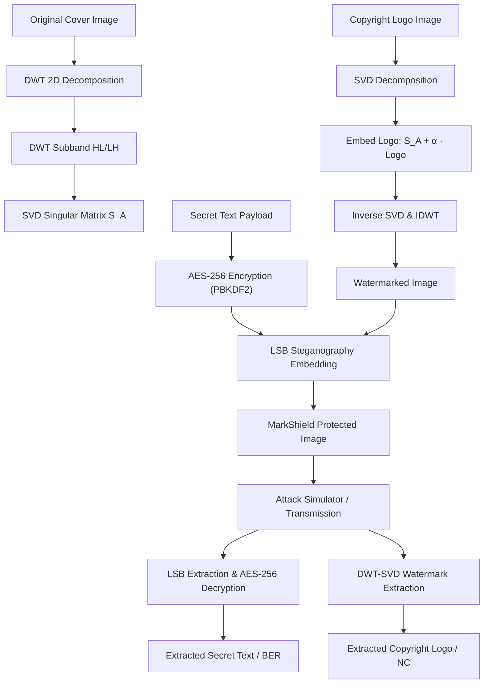

# 🛡️ MarkShield: Hybrid Digital Watermarking & Steganography Engine

[](https://www.python.org/)
[](https://streamlit.io/)
[](LICENSE)

**MarkShield** is a production-grade Python platform that unifies frequency-domain **Digital Watermarking (DWT-SVD)** with spatial-domain **AES-256 Encrypted Steganography (LSB)** into a dual-layer media protection system.

---

## 🌟 Key Features

- **📖 In-Depth Project Guide**: For an exhaustive guide on theory, mathematics, and UI walkthrough, refer to [PROJECT_GUIDE.md](PROJECT_GUIDE.md).
- **Dual-Layer Protection**:
  - **Layer 1 (Copyright Watermarking)**: Embeds visual copyright logos into high-frequency image bands using Discrete Wavelet Transform and Singular Value Decomposition (DWT-SVD).
  - **Layer 2 (Secret Steganography)**: Encrypts arbitrary text payloads using AES-256-CBC (PBKDF2HMAC key derivation) and embeds them into least-significant-bits (LSB).
- **Interactive Streamlit Web Dashboard**:
  - **Tab 1: Protect & Embed**: Interactive controls to load cover image & copyright logo, set AES-256 password, tune watermark strength ($\alpha$), and download protected image + key file.
  - **Tab 2: Extract & Authenticate**: Extract secret text payloads and verify copyright logo authenticity.
  - **Tab 3: Robustness & Attack Test Suite**: Real-time attack simulator testing JPEG compression, Gaussian noise, Salt & Pepper noise, center cropping, and brightness shifts.
- **Quantitative Quality & Robustness Suite**:
  - **PSNR** (Peak Signal-to-Noise Ratio)
  - **SSIM** (Structural Similarity Index Measure)
  - **NC** (Normalized Cross-Correlation)
  - **BER** (Bit Error Rate)

---

## 🏗️ Architecture Diagram



<details>
<summary><b>🔍 View Mermaid Diagram Source Code</b></summary>



</details>

---

## 📐 Mathematical Foundations

### 1. DWT-SVD Digital Watermarking
1. **Discrete Wavelet Transform (2D DWT)**:
   Decomposes image channel $A$ into subbands:
   $$A \xrightarrow{DWT} \{LL, LH, HL, HH\}$$
2. **Singular Value Decomposition (SVD)**:
   Applied to chosen subband (e.g. $HL$):
   $$HL = U_A \cdot S_A \cdot V_A^T$$
3. **Watermark Embedding**:
   $$M = \text{diag}(S_A) + \alpha \cdot W_{normalized}$$
   $$M = U_M \cdot S_M \cdot V_M^T$$
   $$HL_{wm} = U_A \cdot \text{diag}(S_M) \cdot V_A^T$$
4. **Inverse DWT (IDWT)**: Reconstructs watermarked image channel $A_{wm}$.

### 2. AES-256 Encrypted LSB Steganography
1. **Key Derivation**: 256-bit key derived via `PBKDF2HMAC-SHA256` with 100,000 iterations and random 16-byte salt:
   $$K = \text{PBKDF2}(P, \text{salt}, 100000)$$
2. **AES-256-CBC Encryption**:
   $$C = \text{AES-256-CBC}_K(\text{PKCS7}(\text{Payload}), \text{IV})$$
3. **LSB Bit Insertion**:
   $$I_{stego}(i, j) = (I(i, j) \land \text{0xFE}) \lor b_k$$

---

## 🚀 Quickstart Installation & Usage

### 1. Clone & Set Up Environment

```bash
git clone https://github.com/your-username/MarkShield.git
cd MarkShield

# Create virtual environment
python -m venv venv

# Activate virtual environment
# On Windows (PowerShell):
.\venv\Scripts\Activate.ps1
# On Linux/macOS:
source venv/bin/activate
```

### 2. Install Dependencies

```bash
pip install -r requirements.txt
```

### 3. Generate Demo Assets & Run App

```bash
# Generate sample cover and logo images
python assets/generate_assets.py

# Launch Streamlit web application
streamlit run app.py
```

Open your browser at `http://localhost:8501`.

---

## 🧪 Running Unit Tests

Run standard `unittest` suite to verify engine functionality:

```bash
python -m unittest discover -s tests -v
```

---

## 📊 Benchmark Results & Evaluation Metrics

| Metric | Target Value | Interpretation |
| :--- | :--- | :--- |
| **PSNR** | $> 35\text{ dB}$ | Imperceptible visual modification |
| **SSIM** | $> 0.98$ | High structural image fidelity |
| **NC** | $> 0.85$ | Highly accurate copyright logo verification |
| **BER** | $0.00$ | Perfect bit-for-bit stego message extraction |

---

## 🛠️ Project Structure

```
MarkShield/
├── .gitignore
├── LICENSE
├── README.md
├── PROJECT_GUIDE.md
├── requirements.txt
├── app.py
├── core/
│   ├── __init__.py
│   ├── stego_engine.py
│   ├── watermark_engine.py
│   ├── attack_simulator.py
│   └── metrics.py
├── assets/
│   ├── generate_assets.py
│   ├── cover_sample.png
│   └── logo_sample.png
└── tests/
    ├── __init__.py
    └── test_engines.py
```

---

## 📄 Tech Stack & License

- **Language**: Python 3.10+
- **GUI Framework**: Streamlit
- **Signal & Image Processing**: PyWavelets, OpenCV, NumPy, scikit-image
- **Cryptography**: `cryptography` (hazmat primitives, AES-256, PBKDF2HMAC)
- **License**: MIT License (see [LICENSE](LICENSE))
